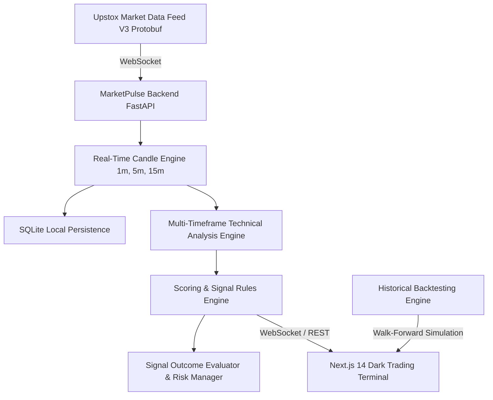

# MarketPulse AI

**MarketPulse AI** is a high-performance, private personal stock market analysis application dedicated strictly to two Indian NSE large-cap equities:
- **HDFCBANK** (`NSE_EQ|INE040A01034`)
- **ICICIBANK** (`NSE_EQ|INE090A01021`)

> **Strict Instrument Policy**: Reliance Industries (`RELIANCE`) is prohibited from the active analysis configuration. All trades are analytical suggestions only with zero broker order execution or automatic trading.

---

## Architecture Overview



### System Components

1. **Market Data Infrastructure (Step 1)**:
   - Official Upstox OAuth 2.0 authorization and secure SQLite token management.
   - Upstox V3 Market Data Feed with binary Protobuf decoding and connection health monitor (`LIVE`, `DELAYED`, `STALE`, `DISCONNECTED`).
   - Pure real-time candle construction for 1m, 5m, and 15m timeframes with strict volume delta calculations.

2. **Technical Analysis & Signal Engine (Step 2)**:
   - **Multi-timeframe strategy**:
     - 15m: Broader market trend, market structure (`HH`, `HL`, `LH`, `LL`), EMA 20/50 alignment.
     - 5m: Setup confirmation, session VWAP, relative volume (`RVOL`), swing support/resistance.
     - 1m: Short-term entry timing and candlestick confirmation.
   - **Liquidity Sweep & False Breakout Detector**:
     - Identifies failed swing high/low breakouts, rejection wicks, and orderbook bid/ask imbalances.
   - **Rules-Based Signals**:
     - Produces `BUY`, `SELL`, or `WAIT` with quantitative scoring (out of 100).
     - Score is an analytical alignment index, never represented as a probability.
   - **Risk Management**:
     - Position sizing adhering to account capital (₹1,00,000 INR default) and risk % (1.0% default).

3. **Trading Terminal, Charts & Backtesting (Step 3)**:
   - **TradingView Lightweight Charts**:
     - Candlesticks with completed and forming bar updates.
     - Synchronized volume histogram bars.
     - Real-time indicator overlays: EMA 20 (`#38BDF8`), EMA 50 (`#EC4899`), VWAP (`#F59E0B`).
     - Sub-chart RSI (14) momentum oscillator with 70 overbought and 30 oversold thresholds.
   - **Signal History & Objective Outcome Tracking**:
     - Tracks signals into `ACTIVE`, `HIT_TARGET`, `HIT_STOP_LOSS`, `EXPIRED`, and `INVALIDATED`.
     - Conservative same-bar resolution: if both SL and Target are touched in the same bar, Stop Loss is assumed hit first.
     - Calculates gross and net P&L after statutory Indian equity charges (brokerage, STT, turnover charges, GST, SEBI fee, stamp duty).
   - **Historical Backtesting Engine**:
     - Chronological walk-forward iteration with strict **zero look-ahead bias**.
     - Walk-forward splits: Train (60%), In-Sample Validation (20%), Out-of-Sample Test (20%).
     - Realistic execution modeling with configurable slippage (0.05% default).
     - Breakdown by market regime: Trending Bullish, Trending Bearish, Sideways, Volatile.
     - Supports validated CSV imports and Upstox historical candle endpoints.
   - **Synthetic Web Audio & Browser Alerts**:
     - Pure Web Audio API synthesized dual-tone chime (880 Hz -> 1320 Hz) requiring no external `.mp3` files.
     - HTML5 desktop notification dispatching.

---

## Setup & Running Instructions

### 1. Backend Setup (FastAPI & Python 3.12)

```bash
cd marketpulse-ai/backend
python -m venv .venv
.venv\Scripts\activate
pip install -r requirements.txt
```

Run test suite:
```bash
pytest tests -v
```

Start backend development server:
```bash
uvicorn app.main:app --host 127.0.0.1 --port 8000 --reload
```

### 2. Frontend Setup (Next.js 14 & Tailwind CSS)

```bash
cd marketpulse-ai/frontend
npm install
npm run build
npm run dev
```

The trading terminal is available at `http://localhost:3000`.

---

## API Endpoints

- `GET /api/health`: System health and instrument configuration.
- `GET /api/market/status`: Connection state, data freshness, and timestamps.
- `GET /api/market/candles`: Multi-timeframe OHLCV candles (1m, 5m, 15m).
- `GET /api/analysis/{symbol}`: Step 2 technical analysis, scoring breakdown, and signal.
- `GET /api/signals/daily-summary`: Today's signal counts, win/loss stats, and risk budget.
- `GET /api/signals/evaluated-history`: Signal history with evaluated trade outcomes.
- `POST /api/backtest/run`: Run walk-forward simulation with custom parameters.
- `POST /api/backtest/upload-csv`: Run backtest on custom 1-minute historical CSV dataset.
- `GET /api/backtest/results/{id}`: Detailed backtest report with split and trade breakdowns.
- `POST /api/risk/settings`: Update trading capital, risk %, and minimum R:R ratio.

---

## Test Verification

The project includes 49 automated test cases covering:
- Zero look-ahead bias validation in historical simulations.
- Conservative same-candle resolution for SL/Target hits.
- Realistic Indian NSE brokerage, STT, turnover fee, GST, and stamp duty calculations.
- Train/Validation/Test walk-forward splits.
- Multi-timeframe candle construction and volume delta math.
- 6 technical indicators (EMA, RSI, VWAP, Volume/RVOL, Market Structure, Support/Resistance).
- 7 candlestick patterns and liquidity sweep detection.
- Strict instrument policy enforcement (blocking any prohibited tickers).
